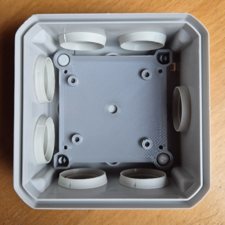
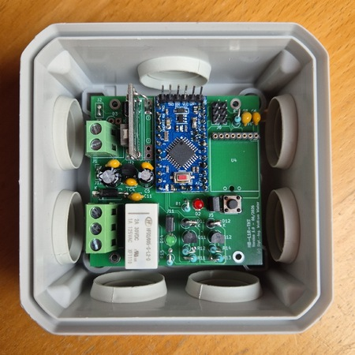
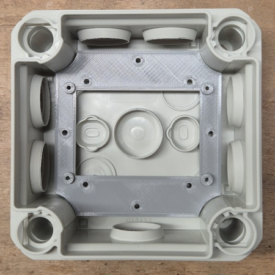
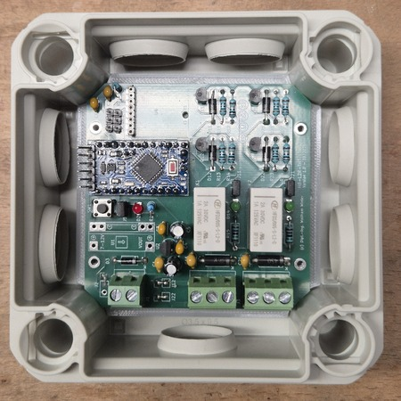

# WW-mySHP - HB-LxR-THT – 'AskSin++' Platinen mit bistabilen Relais (THT)

[Zurück zur Übersicht ...](../README.md)

### Projekt-Beschreibung

Es war das Ziel einen 'Asksin++' Schaltaktor (1-/2-kanalig) mit bistabilen Relais zu entwerfen, der von der zu schaltenden Versorgungsspannung (5 V - 12 V) gespeist wird - alternativ soll er auch potentialfrei Fremdspannungen schalten können. Nach einem Spannungsverlust soll der ursprüngliche Relaiszustand beibehalten / wiederhergestellt werden. 

Dazu wurden die 'Asksin++' Platinen **HB-L1R-THT** (1 Kanal) und **HB-L2R-THT** (2 Kanäle) mit **HONGFA HFD2/005-S-L2-D bistabilen Relais** entwickelt.

- [Zeigen 'AskSin++' Platinen - HB-LxR-THT ...](https://github.com/wolwin/WW-myPCB/blob/master/PCB_HB-LxR-THT/README.md "'AskSin++' Platinen - HB-LxR-THT")

Für die Relaisplatinen **HB-L1R-THT** und **HB-L2R-THT** wurde eine 'AskSin++'-Firmware entwickelt, die wahlweise einen **HM-LC-Sw1-Pl** oder **HM-LC-Sw2-FM** kompatiblen 'HomeMatic'-Schaltaktor nachbildet. Die Firmware ist speziell für die THT-Platinen **HB-L1R-THT** und **HB-L2R-THT** entwickelt worden.

- Weitere **wichtige Firmware-Details** &nbsp;&nbsp;[... finden sich hier ...](README_Firmware.md "Firmware-Details")

### Eigenschaften
- Unterstützung von **1 oder 2 Schaltkanälen**
- bistabile Relais mit SET-/RESET-Ansteuerung
- EEPROM-Speicherung des Relaiszustands
- verschiedene Boot-Synchronisationsmodi
- lokale Taster für jeden Kanal
- 'HomeMatic'-kompatibel
- interne Peerings
- geringer Stromverbrauch durch Idle-Sleep

### Hardware

#### Unterstützte 'Asksin++' Platinen
- **HB-L1R-THT** (1 Kanal)
- **HB-L2R-THT** (2 Kanäle)

#### Relais
- HONGFA **HFD2/005-S-L2-D**
- bistabiles Doppelspulenrelais

#### Mikrocontroller
- Arduino Pro Mini 8 MHz / ATmega328P

#### Funkmodul
- CC1101

### INO-Skript
- Version - 2026-08-05 &nbsp;&nbsp;&nbsp;&nbsp;[Download 'INO-Skript - HB-LxR-THT' ...](./bin/HB-LxR-THT_20260805.zip "INO-Skript - HB-L1R-THT")

- Alle wichtigen Informationen zu 'AskSin++' findet man auf der 'AskSin++'-Side - [Zeigen ...](https://asksinpp.de/)

### 3D-Print
Da die **HB-L1R-THT** und **HB-L2R-THT** Platinen im Außenbereich zum Einsatz kommen sollen, wurden Befestigungsadapter für die OBO-Toolbox entworfen.
  - Version - 2026-08-04 &nbsp;&nbsp;&nbsp;&nbsp;[Download 'OBO Adapter für HB-LxR-THT' ...](./bin/OBO_HB-LxR-THT_20260804.zip "OBO Adapter für HB-LxR-THT")

  - Zur Befestigung im OBO Gehäuse werden noch vier 'Blechschrauben DIN 7981 TX Edelstahl VA Linsenkopf 3,5 x 9,5 mm' benötigt. Die Platinen werden jeweils mit vier 'Blechschrauben DIN 7981 TX Edelstahl VA Linsenkopf 2,2 x 6,5 mm' verschraubt.

- [Zeigen 'OBO-Toolbox ...](https://github.com/wolwin/WW-my3DP/blob/master/3DP_OBO/README.md "OBO-Toolbox")

### Bilder
- OBO T40 - HB-L1R-THT (V 1.0 - 12 Volt)  

  
- OBO T60 - HB-L2R-THT (V 1.0 - 5 Volt)  

### Historie
- 2026-08-06 - Erstveröffentlichung
  - Version 1.1 - 08-2026

